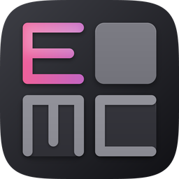
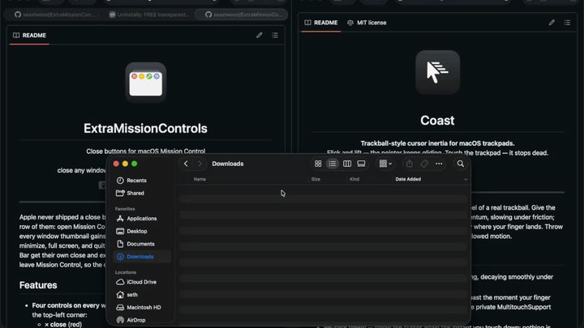

<p align="center">
  
</p>

<h1 align="center">Extra Mission Controls</h1>

<p align="center">
  Close buttons for macOS Mission Control <br></br>
  close, minimize, full-screen, arrange, or quit any window right from the overview.
</p>

<p align="center">
  <a href="https://buymeacoffee.com/eastwoodsee">
    
  </a>
</p>

<p align="center">
  
</p>

---

Apple never shipped a close button in Mission Control. This menu-bar app adds
a whole row of them: open Mission Control the way you always do (swipe up / ⌃↑
/ F3) and every window thumbnail gains **macOS-style controls in its top-left
corner** — close, minimize, full screen, arrange (snap to a half or maximize),
and quit — with hover highlighting. Click one and it applies as you leave
Mission Control, so the overview never breaks.

## Features

- **Five controls on every window thumbnail**, laid out like the macOS traffic
  lights in the top-left corner:
  - **✕ close** (red)
  - **− minimize** (yellow) — to the Dock
  - **⤢ full screen** (green)
  - **◫ arrange** (teal) — hover it for a moment (or click) for a menu to snap
    the window to the **left** or **right half** of its screen, or **maximize**
    it to fill the desktop (below the menu bar, clear of the Dock — not macOS
    full screen)
  - **⏻ quit** (purple) — quits the whole app with ⌘Q, so it can still prompt
    to save unsaved work. Hover it for a moment (or right-click) to open a menu
    with **Force Quit** (⏼) and **Force Kill** (⭘) for apps that won't go
    quietly
  - Buttons a window can't use are hidden: no ⤢ on windows that can't go full
    screen, no Maximize for fixed-size windows (e.g. System Settings)
- Close, minimize, quit, and arrange are **deferred until you leave Mission
  Control**:
  the thumbnail dims with the pending symbol so you can see what's queued, and
  nothing is left behind as a dead "ghost" thumbnail
- Changed your mind? Any dimmed thumbnail or tile shows a **↺ cancel** button
  (blue) — click it to call off the pending action and bring the buttons back,
  so you can pick a different one or leave the window alone (for a fullscreen
  app that already dropped to the desktop, cancel keeps it open as a window)
- **Fullscreen apps in the Spaces Bar (top section)**: through macOS 26 they
  get a **✕** that closes the app's window and a **❏** that exits full screen,
  both without leaving Mission Control. On macOS 27 the Spaces Bar has no EMC
  buttons: use macOS's own exit-full-screen button on the tile, then close the
  window from its thumbnail.
- **Keyboard shortcuts**: point at a window thumbnail and press **W** to close
  it, **M** to minimize it, or **Q** to quit its app (press the same key again
  to take it back). macOS may ask for *Input Monitoring* permission the first
  time; without it everything else still works
- **Middle-click** a window thumbnail to close it
- **Dock bubble**: in Mission Control, rest the pointer on a running app's
  Dock icon for a menu to **Hide** it, **Close All Windows**, **Quit**, or
  **Force Quit** — with the app's name as the caption, sitting over the
  Dock's own name label. The icon dims with the pending action and shows a
  **↺** to undo
- **Open at Login** from the menu-bar dropdown
- Split View tiles get a single **✕2** button that closes both apps of the
  split (closing just one half is not reliably possible on macOS)
- Buttons, their flyout menus, and the tray behind each row render with
  **Liquid Glass** on macOS 26+ (a translucent dark disc on older systems),
  monochrome by default; turn on **Colors** in the menu-bar dropdown for
  traffic-light hues
- Buttons track Mission Control's layout live (thumbnail re-flow, Spaces Bar
  expanding/shrinking) and scale down on small tiles
- Just a menu-bar item — no Dock icon, no windows of its own
- Near-zero idle cost: one cheap WindowServer query 4×/s (with timer
  tolerance so macOS coalesces wake-ups) that **stops entirely while the
  display is asleep**; window references refresh only on real events (launch,
  space switches, app activations) instead of polling, so no other app is ever
  woken while you're not using Mission Control. On macOS 27, where Mission Control's
  windows changed, the app learns which windows mark Mission Control from your
  first session or two (asking the accessibility tree directly until then),
  remembers it per macOS build, and drops back to the one cheap query

## How it works

Mission Control is rendered by the system and cannot be modified directly,
but its thumbnail layout is published through the Accessibility API, with one
`AXButton` per thumbnail exposing title/position/size. Through macOS 26 it is
the `Dock` process that publishes it (an `AXGroup` with identifier `mc` appears
in its AX tree while Mission Control is active, holding `mc.display` →
`mc.windows`). macOS 27 moved it to the `WindowManager` process: its
application element holds the `mc.display` groups directly, the thumbnails
sit straight under `mc.display` (no `mc.windows`), and Spaces Bar tiles report
their center as their position. The Dock keeps only an empty `mc` stub. The app
reads whichever host has the populated tree. This app:

1. polls that AX tree to detect Mission Control opening, then re-syncs
   button positions at 10 Hz so they track thumbnails re-flowing and the
   Spaces Bar expanding/shrinking (✕ buttons scale down on small tiles),
2. floats a tiny always-on-top ✕ panel over each window thumbnail and each
   fullscreen app's Spaces Bar tile (never plain "Desktop N" tiles),
3. intercepts clicks on those rects with a `CGEventTap` (while Mission Control
   is up, WindowServer routes mouse events to the Dock even though our panels
   render on top — the tap claims clicks on our buttons before the Dock sees
   them, and only those clicks), and
4. queues the action and applies it the instant Mission Control closes.
   Closing, minimizing, or quitting a window *in place* while the overview is
   still open leaves a dead "ghost" thumbnail the Dock keeps for the rest of
   the session (clicking it would reopen the app), so instead the thumbnail
   dims with the pending symbol and the real action — pressing the window's
   close/minimize button, resizing it for a left/right/maximize snap, or asking
   its app to quit (⌘Q) — runs as you leave.

Fullscreen apps take a different route (through macOS 26). Closing one from
the Spaces Bar first drops it back to the desktop in place (`AXRemoveDesktop` —
you stay in Mission Control), where it reappears as an ordinary window thumbnail with the dim ✕
scrim; the window is queued for closing as you leave. The **❏** button performs
just the fullscreen exit, leaving the
app windowed. (An accumulative registry of fullscreen
windows — scanned while Mission Control is closed, refreshed on every space
switch — keeps AX references pressable from any space for the fallback paths.)

Apps with a hollow accessibility tree (Steam) expose no close/minimize button
at all. For those, the deferred action falls back to a synthetic click on the
real traffic-light button once Mission Control is gone — it raises the window
and clicks the button at the window's top-left corner. Full screen likewise
falls back from the window's own AX full-screen button to a click on the green
button.

## Install

Requires macOS 13 or later (developed and tested on macOS 26; updated for macOS 27).

### 1. Download

Grab the latest `Extra Mission Controls <version>.dmg` from the
**[Releases page](../../releases)**.

### 2. Install

Open the DMG and drag **Extra Mission Controls** into the **Applications**
folder.

### 3. First launch (unsigned-app hoop, one time only)

This is a free, open-source app and is **not notarized by Apple** (that
requires a paid Apple Developer subscription), so macOS blocks the very first
launch. Getting past it is a one-time step:

**macOS 15 Sequoia and later** (the right-click trick no longer works):

1. Double-click the app once — macOS shows *"Apple could not verify…"* /
   *"was not opened"*. Click **Done**.
2. Open **System Settings → Privacy & Security**, scroll to the bottom — you
   will see *"Extra Mission Controls" was blocked…* Click **Open Anyway**.
3. Confirm **Open Anyway** in the dialog (authenticate if asked).

**macOS 13–14:** right-click (Control-click) the app in Applications →
**Open** → **Open**.

Every later launch opens normally.

### 4. Grant permissions

The app prompts for Accessibility on first launch (it is the only permission it needs); grant it in
**System Settings → Privacy & Security**:

| Permission | Why the app needs it | Without it |
|---|---|---|
| **Accessibility** | Detecting Mission Control, receiving ✕ clicks, pressing windows' close buttons | Nothing works |

Then **quit and relaunch the app** (menu-bar icon → Quit) — macOS applies
permissions only to newly launched processes.

That's it: the grid icon sits in your menu bar; open Mission Control and
every window gets its row of controls.

**Updating:** just replace the app with the one from a newer DMG — builds are
signed with a stable identity, so your permissions carry over.

## Development

### From source

```sh
git clone https://github.com/seastwood/ExtraMissionControls.git
cd ExtraMissionControls
python3 -m venv .venv
.venv/bin/pip install -r requirements.txt
.venv/bin/python main.py
```

Python 3.9+ with [PyObjC](https://pyobjc.readthedocs.io/) (installed by
`requirements.txt`).

### Running from PyCharm

1. Open this folder as a project.
2. **Settings → Project → Python Interpreter → Add Interpreter → Existing**,
   pick `.venv/bin/python`.
3. Run `main.py`.

When running from source, the permissions above must be granted to
**whichever app launches the Python process** (PyCharm or your terminal),
and that app must be fully restarted after granting.

## Building the DMG

```sh
./scripts/build_dmg.sh
```

Runs py2app and produces `dist/Extra Mission Controls <version>.dmg` with a
drag-to-Applications layout, app icon, and volume icon. The icon itself is
generated by `scripts/make_icon.py` (drawn with Pillow: a monochrome miniature
Mission Control with EMC's ✕ button).

## Permissions that survive updates (code signing)

macOS ties granted permissions to an app's **code-signing identity**, not its
name or location. An unsigned / ad-hoc app's identity is a hash of its binary,
which changes on every build — so each update looks like a brand-new app and
Accessibility gets **reset**.

To fix this, every build is signed with a **stable** identity, so the signing
requirement (`identifier + certificate leaf`) is identical across rebuilds and
permissions persist. `build_dmg.sh` picks, in order:

1. `$EMC_SIGN_IDENTITY` if set;
2. a **Developer ID Application** certificate if you have one (best — also
   passes Gatekeeper when notarized);
3. otherwise a **self-signed** identity it creates on first build via
   `scripts/setup_signing.sh`.

The self-signed identity is generated once and backed up to
`~/.config/extramissioncontrols/emc-signing.p12` so the *same* identity is
reused even if the keychain or repo is deleted (**keep this file** — losing it
resets everyone's permissions on the next update). It lives in a dedicated
`emc-signing` keychain; nothing sensitive is stored.

**First install of the signed app:** because the identity changed from the old
ad-hoc build, grant the permissions once more (and remove any stale
Extra Mission Controls entries in System Settings → Privacy & Security first).
Every update after that keeps them.

**Gatekeeper:** a self-signed app isn't notarized, so macOS blocks the first
launch — see [First launch](#3-first-launch-unsigned-app-hoop-one-time-only)
above for the one-time steps. Distribution without that hoop would require a
paid Developer ID certificate and notarization.

## Testing

Automated end-to-end tests (they briefly take over screen and mouse: opening
Mission Control, clicking ✕ buttons with synthetic events, verifying windows
really closed):

```sh
.venv/bin/python scripts/test_mc_e2e.py                    # Finder victim
EMC_VICTIM=textedit .venv/bin/python scripts/test_mc_e2e.py # held-ref path
.venv/bin/python scripts/test_mc_fullscreen_e2e.py          # Spaces Bar tile
```

Debugging: run with `EMC_DEBUG=1` to log actions and button layouts to
`emc_actions.log` and dump the first few Mission Control layouts to
`emc_diag.txt` (both gitignored). Normal runs write nothing.

## Project layout

| File | Purpose |
|---|---|
| `main.py` | Entry point (run this in PyCharm) |
| `extra_mission_controls/app.py` | Menu-bar shell, permission prompts |
| `extra_mission_controls/mission_control.py` | ✕ buttons over Mission Control (AX polling + event tap + close chains) |
| `extra_mission_controls/windows.py` | Window enumeration (CG window list) |
| `extra_mission_controls/ax.py` | Mission Control AX tree reading (Dock / WindowManager); window close primitives |
| `extra_mission_controls/ui.py` | Shared button, flyout-menu, and Liquid Glass styling |
| `scripts/make_icon.py` | Generates the app/volume icon |
| `scripts/setup_signing.sh` | Creates the stable self-signed signing identity |
| `scripts/probe_dock_ax.py` | Dev tool: dump the Dock's and WindowManager's AX trees with Mission Control open |
| `scripts/test_mc_e2e.py` | E2E test: window thumbnails |
| `scripts/test_mc_fullscreen_e2e.py` | E2E test: Spaces Bar fullscreen tiles |
| `setup.py`, `scripts/build_dmg.sh` | py2app + DMG packaging |

## Known limitations

- Mission Control's AX layout (`mc` / `mc.display` / `mc.windows`
  identifiers, and which process hosts it) is undocumented and changes between
  macOS releases. This is the fragile part of the technique. It was verified on
  macOS 26, and macOS 27 moved it from the Dock to WindowManager. If buttons stop
  appearing after an update, run `scripts/probe_dock_ax.py` and compare its dump
  with the layout described above.
- Windows are matched to thumbnails by title; two windows with identical
  titles in the same app may close the wrong twin.
- Buttons appear on the current display only (multi-monitor support TODO).
- On macOS 27, Spaces Bar tiles get no EMC buttons. macOS's exit-full-screen
  button there is invisible to accessibility and window lists, so a synthetic
  click on it can't be guaranteed to land (a miss opens the app), and direct
  `AXFullScreen` writes left Notes visually broken while reporting success.
  On earlier systems, fullscreen windows the app has never had AX sight of may
  close via a fallback that briefly leaves Mission Control and returns.

## Support

If this scratches an itch Apple wouldn't:
**[buy me a coffee ☕](https://buymeacoffee.com/eastwoodsee)**
